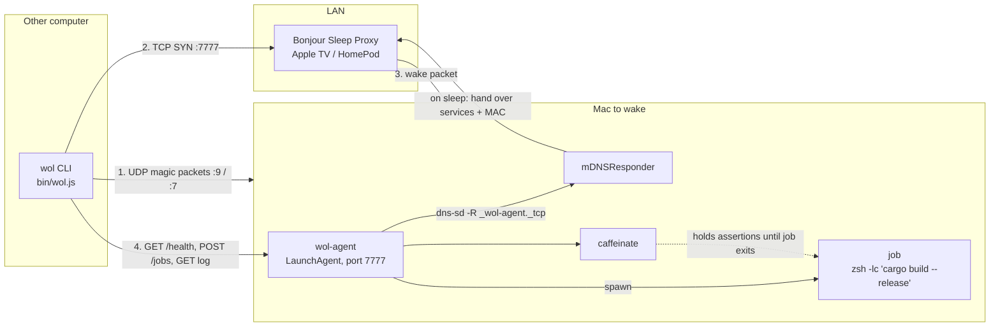
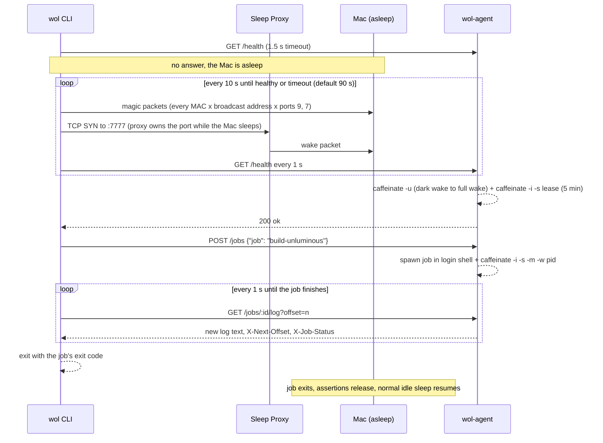

# wake-on-lan

Wake a sleeping Mac over the LAN and hand it work, such as "pull and build this repo", from another machine on the same
network (for example one running Claude Code or a CI-style script).

```sh
wol run build-unluminous
# [wol] wake round 1: sent 4 magic packet(s), probing my-mac.local:7777
# [wol] my-mac.local woke after 6s
# [wol] started build-unluminous as m3k2x1-a1b2c3
#    Compiling unluminous v0.1.0 ...
# [wol] build-unluminous succeeded (exit 0)
```

One command wakes the Mac, waits for it to answer, starts a pre-approved job, streams its log, and exits with the
job's exit code. The Mac is kept awake for exactly as long as the job runs, then goes back to sleeping normally.

- No dependencies. Only Node ≥ 18 on both machines.
- Two programs: **`wol-agent`** (runs on the Mac) and **`wol`** (the CLI you run on the other machine).
- More detail: [docs/how-it-works.md](docs/how-it-works.md) explains each mechanism, and the original design is in
  [tasks/wake-on-lan-tdd.md](tasks/wake-on-lan-tdd.md).

## Why this isn't just a magic packet
A sleeping Mac's ports are closed, so SSH and HTTP fail. Classic Wake-on-LAN magic packets are unreliable on Apple
Silicon, especially over Wi-Fi. And even when a network wake works, macOS usually lands in **dark wake**, a
background-only state where `caffeinate -i` is ignored, so the Mac falls back asleep within a minute, before a build
can start.

This project combines the wake paths macOS *does* support with a small agent that holds the Mac awake properly:

1. **Bonjour Sleep Proxy.** The agent advertises its port over Bonjour. When the Mac sleeps, macOS hands that
   registration to a sleep proxy on the LAN (an Apple TV or HomePod). Any TCP connection attempt to the port makes the
   proxy send the Mac a wake packet. This is the path that works on Wi-Fi.
2. **Magic packets.** The CLI also broadcasts standard magic packets to every MAC you configure, for Ethernet and
   Wake-on-Wireless setups.
3. **Dark wake to full wake.** The first request the agent sees triggers `caffeinate -u` (declare user activity), which
   promotes dark wake to full wake, plus a `caffeinate -i -s` lease so the Mac stays up long enough to receive the job.
4. **Hold awake while the job runs.** Each job gets its own `caffeinate -i -s -m -w <pid>`, so the Mac cannot sleep
   until the job's process exits.

## Architecture


## What happens during `wol run <job>`


## Set up the Mac to be woken
```sh
git clone https://github.com/jasonmcaffee/wake-on-lan.git && cd wake-on-lan
./scripts/setup-mac.sh          # writes config, installs the LaunchAgent, prints the client config to copy
./scripts/setup-mac.sh --power  # also runs: sudo pmset -c womp 1 tcpkeepalive 1 autorestart 1
```
`setup-mac.sh`:
- writes `~/.config/wol-agent/config.json` (mode 600) with a random 48-character token, unless it already exists;
- installs `~/Library/LaunchAgents/com.wol.agent.plist` so the agent runs whenever you are logged in, and restarts it;
- checks the agent answers on port 7777, lists the sleep proxies it can see, and warns about a private Wi-Fi address;
- prints a ready-to-copy client config containing the host name, token, MAC addresses, broadcast address and fallback IP.

Requirements:
- The Mac must be **on AC power**. macOS does not network-wake a laptop on battery.
- A **Bonjour Sleep Proxy** (Apple TV or HomePod) must be on the same LAN for Wi-Fi wake.
- In System Settings ▸ Wi-Fi ▸ Details, set **Private Wi-Fi Address** to *Fixed* or *Off* for this network, so the MAC
  the magic packets target does not rotate.

To remove the agent, run `./scripts/uninstall-mac.sh` (config and logs are left in place).

### Configure jobs
Jobs live in `~/.config/wol-agent/config.json`:
```json
{
  "port": 7777,
  "host": "0.0.0.0",
  "token": "<generated>",
  "allowArbitraryCommands": false,
  "keepAwakeSeconds": 300,
  "advertiseBonjour": true,
  "jobs": {
    "build-unluminous": {
      "description": "Release build of Unluminous",
      "cwd": "~/Documents/dev/unluminous",
      "command": "git pull --ff-only && cargo build --release"
    },
    "uptime": { "description": "Smoke test", "command": "uptime" }
  }
}
```
Jobs run in your login shell (`$SHELL -lc`), so cargo, nvm and brew are on PATH. Only named jobs can run unless you set
`"allowArbitraryCommands": true`. Restart the agent after editing (`./scripts/setup-mac.sh` keeps the existing config
and reloads it). Logs are written to `~/.wol-agent/` (`agent.log`, `logs/<id>.log`, and `jobs.jsonl` as an audit trail).

## Use it from another machine
Clone the repo, then save the config that `setup-mac.sh` printed as `~/.config/wol/config.json`:
```json
{
  "host": "my-mac.local",
  "port": 7777,
  "token": "<same token as the agent>",
  "macs": ["aa:bb:cc:dd:ee:ff"],
  "broadcasts": ["192.168.1.255", "255.255.255.255"],
  "fallbackIp": "192.168.1.20",
  "wakeTimeoutSeconds": 90
}
```
```sh
node bin/wol.js status                    # is it awake? (never wakes it)
node bin/wol.js wake                      # wake and wait for the agent
node bin/wol.js jobs                      # list allowed jobs and recent runs
node bin/wol.js run build-unluminous      # wake, build, stream log, exit with the build's exit code
node bin/wol.js run build-unluminous --no-follow   # start it and print the run id
node bin/wol.js exec "make test" --cwd ~/src/app   # arbitrary command (agent must allow it)
node bin/wol.js logs <id>                 # stream a run's log until it finishes
node bin/wol.js cancel <id>               # cancel a run (SIGTERM to its process group)
node bin/wol.js keep-awake 3600           # hold the Mac awake for an hour
node bin/wol.js magic                     # only broadcast magic packets
```
`npm link` (or `npm i -g .`) puts `wol` and `wol-agent` on your PATH.

The flags `--host --fallback-ip --port --token --mac --broadcast --timeout` and the env vars `WOL_HOST`, `WOL_PORT`,
`WOL_TOKEN` and `WOL_CONFIG` override the config file. Progress goes to stderr and job output to stdout, so
`wol run x > build.log` captures just the build. Exit codes: the job's exit code, or `2` if the wake or an API call fails.

## HTTP API
Port 7777. Every route except `/health` needs `Authorization: Bearer <token>`. Every request, including `/health`,
extends the keep-awake lease.

| Method | Path | Result |
|---|---|---|
| GET | `/health` | `{ ok, hostname, version, uptimeSeconds }` |
| GET | `/jobs` | `{ jobs: { name: description }, allowArbitraryCommands, runs }` |
| POST | `/jobs` | body `{ job }` or `{ command, cwd }` → `202` run record (`403` arbitrary disabled, `404` unknown job) |
| GET | `/jobs/:id` | run record `{ id, name, command, cwd, status, exitCode, pid, startedAt, finishedAt }` |
| GET | `/jobs/:id/log?offset=n` | log text from byte `n`; headers `X-Next-Offset`, `X-Job-Status` |
| POST | `/jobs/:id/cancel` | cancels the run |
| POST | `/keep-awake` | body `{ seconds }` (max 6 h) holds the Mac awake without a job |

## Security
- The token is random and compared in constant time. `/health` is open and reveals only the host name.
- By default only named jobs from the config can run. Anyone with the token can run those jobs as your user.
- Traffic is plain HTTP, so the token can be sniffed on the LAN. That is acceptable on a home network; use Tailscale
  or WireGuard otherwise. Request bodies are capped at 64 KB.

## Limits
- It cannot power on a Mac that is shut down (use `pmset autorestart 1` for power loss).
- Magic packets and Bonjour are link-local, so it only works on the same LAN (or over a VPN that bridges it).
- No network wake on battery or with the lid closed on battery.

## Troubleshooting
- `pmset -g log | grep -E "Wake from|DarkWake" | tail` shows why the Mac woke.
- `pmset -g assertions` shows what is keeping it awake (look for `caffeinate`).
- `dns-sd -B _sleep-proxy._udp` lists the sleep proxies; `dns-sd -B _wol-agent._tcp` should list the agent.
- `tail -f ~/.wol-agent/agent.log` on the Mac shows requests and jobs.
- If wake is unreliable on your network, run `sudo pmset -c sleep 0` (the display still sleeps; the Mac never does).

## Tests
`npm test` runs integration tests with `node:test`. They start the real agent and drive it with the real CLI: magic
packet format and delivery, auth, job success and failure exit codes, cancel, arbitrary-command gating, and a simulated
wake where the agent only comes up after `wol wake` has started.

## Project layout
```
bin/            wol.js (CLI), wol-agent.js (agent entry point)
src/models/     JSDoc types
src/utils/      config, magic packets, caffeinate keep-awake
src/repositories/ job records and logs
src/services/   HTTP server, job runner, Bonjour advertising, API client, wake loop
scripts/        setup-mac.sh, uninstall-mac.sh
launchd/        LaunchAgent plist template
docs/           how-it-works.md
test/           integration tests
```

## License
MIT
