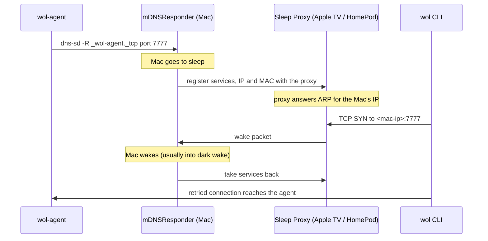
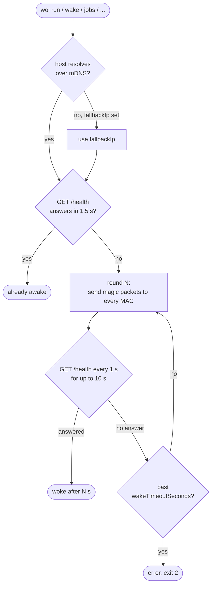
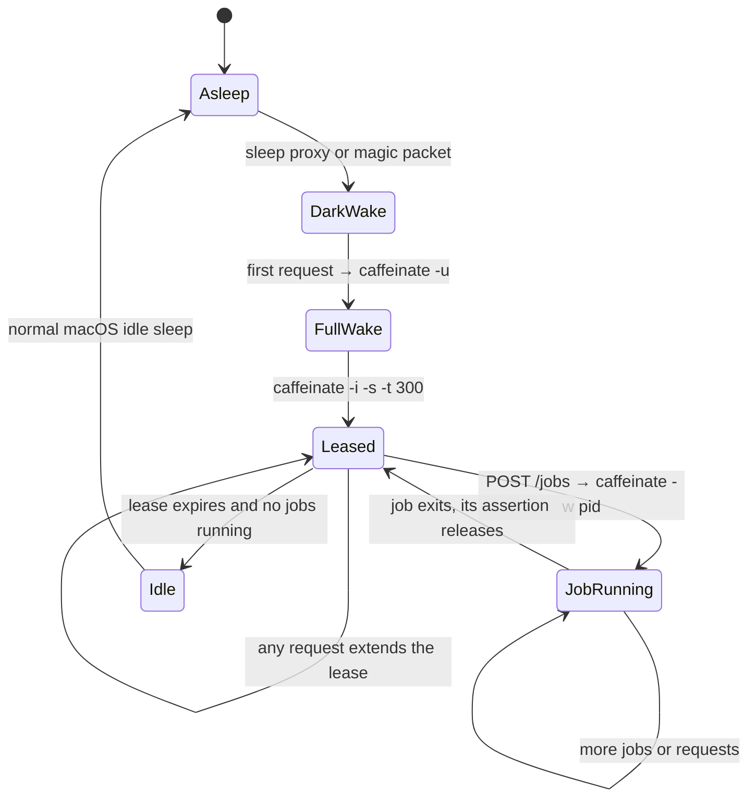
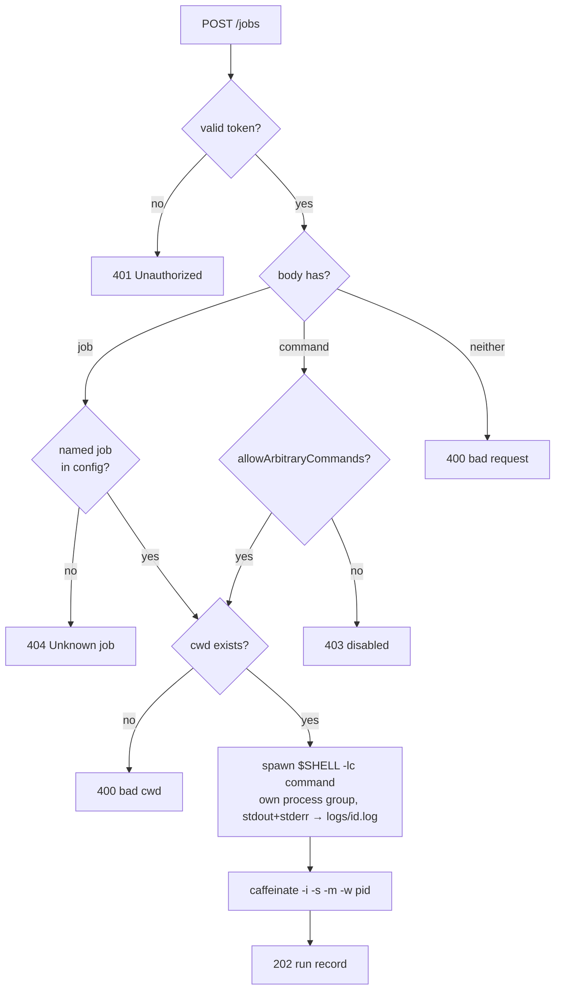
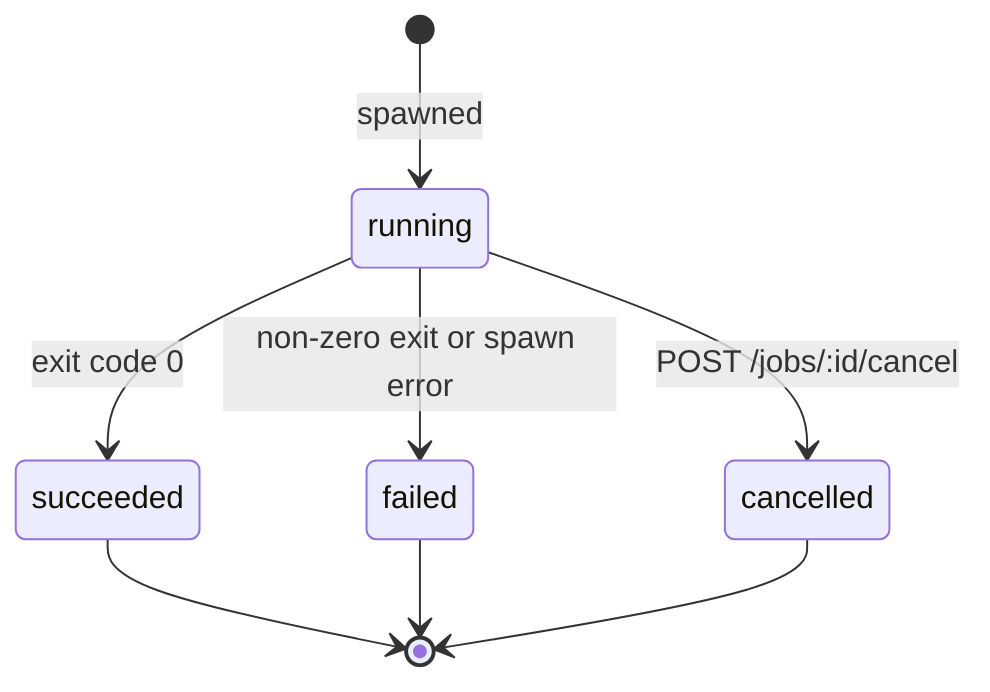

# How it works

This page walks through each mechanism in order: how the Mac gets woken, how it is kept awake, how a job runs, and how
the CLI follows it. The README has the overview; the original design notes are in
[../tasks/wake-on-lan-tdd.md](../tasks/wake-on-lan-tdd.md).

## 1. Being reachable while asleep: the Bonjour Sleep Proxy
`wol-agent` runs `dns-sd -R "wol-agent on <host>" _wol-agent._tcp local 7777` for as long as it is alive
(`src/services/bonjourService.js`, restarted if it dies). This registers the agent's port with `mDNSResponder`.

When the Mac goes to sleep, `mDNSResponder` hands its registered services, IP address and MAC address to a **Bonjour
Sleep Proxy** on the LAN (Apple TVs and HomePods do this). While the Mac sleeps, the proxy answers ARP for the Mac's
IP and watches for connections to the registered ports. When a TCP SYN arrives for port 7777, the proxy sends the Mac a
wake packet and steps aside.

This is why the agent advertises itself at all: without the Bonjour registration the proxy would not know the port
matters and would ignore the SYN.

## 2. Magic packets as a second path
`src/utils/magicPacket.js` builds standard Wake-on-LAN magic packets: 6 bytes of `0xFF` followed by the target MAC
repeated 16 times (102 bytes). The CLI sends one per MAC × broadcast address × port (9 and 7). It sends to both the
private Wi-Fi MAC and the hardware MAC when they differ, because which one the Wi-Fi chip listens for depends on the
setup. On Ethernet, or Macs that support Wake on Wireless, these alone can wake the machine.

## 3. The wake loop in the CLI
`src/services/wakeService.js` drives both paths together and stops as soon as the agent answers.

Each `/health` probe is itself a TCP connection attempt to port 7777, which is what the sleep proxy reacts to, so the
probing is not just waiting: it is the wake trigger.

## 4. Staying awake: dark wake and caffeinate
A network wake usually lands the Mac in **dark wake**. In dark wake macOS ignores `PreventUserIdleSystemSleep`
(`caffeinate -i`), so a naive agent would wake, answer, and be asleep again 30–60 seconds later.

`src/utils/keepAwake.js` handles this with two kinds of `caffeinate` assertion:

| When | Command | Effect |
|---|---|---|
| First request after idle | `caffeinate -u -t 5` | declares user activity, promoting dark wake to a full wake (the display turns on briefly) |
| Every request | `caffeinate -i -s -t <keepAwakeSeconds>` | a lease (default 5 min) preventing idle and system sleep; replaced only if the new one ends 5 s or more later |
| Each job | `caffeinate -i -s -m -w <pid>` | prevents idle, system and disk sleep until the job's process exits |

`-s` (PreventSystemSleep) is only honoured on AC power, which is one reason the Mac must be plugged in.

## 5. Running a job
`src/services/agentServer.js` checks the bearer token (constant-time compare) on every route except `/health`, then
`src/services/jobService.js` decides what to run:

Jobs run in the user's login shell so the user's toolchain (cargo, nvm, brew, git credentials) is on PATH. That is
also why the agent is a LaunchAgent (runs as you, while you are logged in) rather than a root LaunchDaemon. Each job
gets its own process group, so cancel can SIGTERM the whole tree.

A run moves through these states:

Runs are kept in memory (the last 200), each finished run is appended to `~/.wol-agent/jobs.jsonl`, and logs stay in
`~/.wol-agent/logs/<id>.log` (`src/repositories/jobRepository.js`).

## 6. Following the log
The CLI polls `GET /jobs/:id/log?offset=n` once a second. The agent returns the log bytes from `n` onward, with
`X-Next-Offset` (where to read next) and `X-Job-Status`. When the status stops being `running`, the CLI reads once more
to catch the tail, prints the result to stderr and exits with the job's exit code. Because every poll is a request, the
keep-awake lease keeps being extended while someone is watching.

## Configuration reference
**Agent** `~/.config/wol-agent/config.json` (override path with `WOL_AGENT_CONFIG`)

| Key | Default | Meaning |
|---|---|---|
| `port` | `7777` | TCP port (also `WOL_AGENT_PORT`) |
| `host` | `0.0.0.0` | listen address |
| `token` | required | shared secret (also `WOL_TOKEN`); the agent refuses to start without one |
| `allowArbitraryCommands` | `false` | allow `{ command }` bodies, not just named jobs |
| `keepAwakeSeconds` | `300` | lease length each request extends to |
| `advertiseBonjour` | `true` | register `_wol-agent._tcp` so the sleep proxy can wake the Mac |
| `dataDir` | `~/.wol-agent` | logs and audit file |
| `jobs` | `{}` | `{ name: { command, cwd, description } }` |

**Client** `~/.config/wol/config.json` (override path with `WOL_CONFIG`)

| Key | Meaning |
|---|---|
| `host` | the Mac's `.local` name or IP (also `WOL_HOST`, `--host`) |
| `fallbackIp` | used when `host` does not resolve (clients without mDNS) |
| `port` | agent port (also `WOL_PORT`, `--port`) |
| `token` | the agent's token (also `WOL_TOKEN`, `--token`) |
| `macs` | MAC addresses for magic packets (`--mac a,b`) |
| `broadcasts` | broadcast addresses (`--broadcast a,b`) |
| `wakeTimeoutSeconds` | how long to keep trying (default 90, `--timeout`) |
