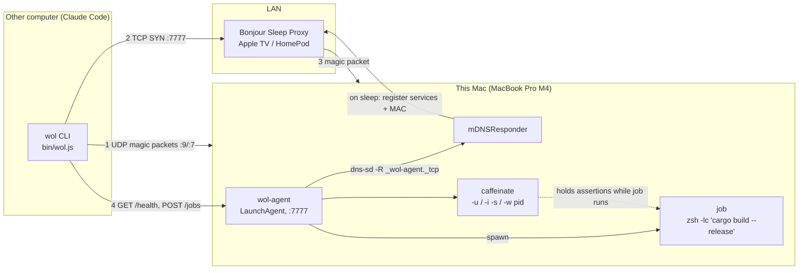
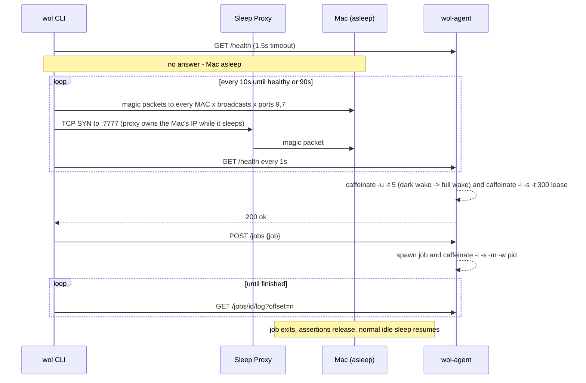

# TDD: Wake this Mac over the LAN and hand it work

## Introduction
Another computer on the LAN (running Claude Code) needs to make this Mac pick up work — e.g. build Unluminous — even
when the Mac is asleep. macOS has no "accept a job while asleep" feature, and classic Wake-on-LAN on Apple Silicon is
unreliable, especially over Wi-Fi. This design combines the wake paths macOS *does* support (Bonjour Sleep Proxy +
magic packets) with a small authenticated job-runner on the Mac that keeps it awake exactly as long as a job runs.

**Target machine (measured):** MacBook Pro M4 (`Mac16,1`), macOS 26.4.1, on Wi-Fi `en0`,
`womp 1` / `tcpkeepalive 1` on AC, kernel `MAGICWAKE` assertion held on `en0`, firewall off,
two Bonjour Sleep Proxies on the LAN (Apple TV/HomePod class devices).

## Goals and Non-Goals
**Goals**
- One command from another machine: `wol run build-unluminous` → wakes the Mac, runs the job, streams the log, exits with the job's exit code.
- The Mac stays awake for the full job, then is free to sleep again normally.
- Works on Wi-Fi via the LAN's sleep proxies; also sends magic packets for Ethernet / WoWLAN-capable setups.
- Only pre-approved jobs run by default; every API call except `/health` needs a shared token.
- Zero dependencies: Node ≥ 18 on both sides.

**Non-Goals**
- Powering on a Mac that is shut down or has lost power (no WoL path exists; use `pmset autorestart 1`).
- Waking from another network/over the internet (magic packets & mDNS are link-local; use a VPN / Tailscale subnet).
- Waking a laptop that is on battery or lid-closed on battery (macOS disables network wake there).
- TLS. The token travels in clear text on the LAN (see Security).

## Problem Statement
- When idle the Mac sleeps; a sleeping Mac's ports are unreachable, so remote tools (SSH, HTTP) fail.
- Magic packets alone are unreliable on Apple Silicon and Wi-Fi (TeamViewer, Apple forums, TidBITS reports), and en0 uses a **private Wi-Fi MAC** that differs from the hardware MAC.
- When a network wake *does* succeed, macOS lands in **dark wake**: a background-only state where `caffeinate -i`
  (PreventUserIdleSystemSleep) is ignored, so the Mac re-sleeps within ~30–60 s — before a build can start.
- Keeping the Mac permanently awake works but wastes power and is not what we want for a laptop.

## Architectural Overview

## Detailed Technical Sections

### Wake sequence

### Components and Interfaces (layered, `src/`)
| Layer | File | Responsibility |
|---|---|---|
| models | `models/types.js` | JSDoc typedefs: `AgentConfig`, `ClientConfig`, `JobRecord` |
| utils | `utils/magicPacket.js` | build (6×`FF` + 16×MAC = 102 B) and broadcast magic packets |
| utils | `utils/keepAwake.js` | `caffeinate` leases: `extend(s)` (promotes to full wake from idle), `holdWhile(pid)` |
| utils | `utils/config.js` | load agent/client config, env + flag overrides, refuse to start without a token |
| repositories | `repositories/jobRepository.js` | in-memory runs (last 200), logs in `~/.wol-agent/logs`, audit `jobs.jsonl` |
| services | `services/jobService.js` | allowlist resolution, spawn in login shell (own process group), cancel, finish |
| services | `services/agentServer.js` | HTTP API + bearer auth; every request extends the keep-awake lease |
| services | `services/bonjourService.js` | `dns-sd -R "wol-agent on <host>" _wol-agent._tcp` (restarts if it dies) |
| services | `services/agentClient.js`, `wakeService.js` | client API calls; wake loop |
| bin | `wol-agent.js`, `wol.js` | entry points |
| scripts | `setup-mac.sh`, `uninstall-mac.sh` | config + LaunchAgent install, optional `pmset`, prints client config |

**HTTP API** (port 7777, `Authorization: Bearer <token>` except `/health`)
| Method | Path | Body / result |
|---|---|---|
| GET | `/health` | `{ ok, hostname, version, uptimeSeconds }` |
| GET | `/jobs` | `{ jobs: {name: description}, allowArbitraryCommands, runs: JobRecord[] }` |
| POST | `/jobs` | `{ job }` or `{ command, cwd }` → `202 JobRecord` (403 if arbitrary disabled, 404 unknown job) |
| GET | `/jobs/:id` | `JobRecord` |
| GET | `/jobs/:id/log?offset=n` | text; headers `X-Next-Offset`, `X-Job-Status` |
| POST | `/jobs/:id/cancel` | SIGTERM to the job's process group |
| POST | `/keep-awake` | `{ seconds }` (≤ 6 h) — hold the Mac awake without a job |

**Agent config** `~/.config/wol-agent/config.json` (mode 600): `port, host, token, allowArbitraryCommands=false,
keepAwakeSeconds=300, advertiseBonjour=true, dataDir, jobs{ name: { command, cwd, description } }`.
**Client config** `~/.config/wol/config.json`: `host, fallbackIp, port, token, macs[], broadcasts[], wakeTimeoutSeconds`.

**Why a LaunchAgent (not a LaunchDaemon):** jobs need the user's toolchain (cargo, nvm, keychain, git credentials) and
the agent is unprivileged. It runs whenever the user is logged in — which sleep preserves.

### Data Flows and Security
- **Auth:** 48-hex-char random token, compared with `timingSafeEqual`. `/health` is open (reveals hostname only).
- **Command execution risk:** default is a named-job allowlist; `allowArbitraryCommands` is an explicit opt-in.
  Jobs run as the user, so anyone with the token can do whatever the allowlisted commands do.
- **Clear text on LAN:** token is sniffable on the LAN. Acceptable for a home LAN; put it behind Tailscale/WireGuard otherwise.
- **Bodies** capped at 64 KB; keep-awake capped at 6 h.
- **Errors:** client exits `2` on wake/API errors, the job's exit code on job failure; agent errors return JSON `{error}` with status.
- **Battery/lid:** macOS refuses network wake on battery and forces sleep on lid-close without AC; the Mac must stay on AC.
- **Private Wi-Fi address:** magic packets target the MAC in use on the LAN. The setup script warns and the client sends
  to both the private and hardware MAC; set "Private Wi-Fi Address" to *Fixed* for this network so it does not rotate.

## Alternatives Considered
| Option | Pros | Cons |
|---|---|---|
| Magic packets only | Standard, simple | Unreliable on Apple Silicon/Wi-Fi; lands in dark wake |
| SSH to wake (Remote Login + sleep proxy) | Built-in, no agent | Needs Remote Login enabled, keys, no job tracking; still dark-wake re-sleep |
| Never sleep (`pmset -c sleep 0` / `disablesleep`) | 100% reliable | Constant power draw/heat on a laptop; still kept as documented fallback |
| Scheduled wakes (`pmset repeat`) + polling a queue | No inbound networking | Latency up to the schedule interval; needs sudo |
| **Sleep proxy + magic packets + agent (chosen)** | Uses supported macOS path, Mac sleeps when idle, job tracking + logs | Depends on an Apple TV/HomePod on the LAN; AC power required |

## Testing Strategy
Automated (`npm test`, `node:test`, real processes — the agent is spawned and driven through the real `wol` CLI):
1. Magic packet format (102 B, 6×FF, MAC×16) and delivery over a real UDP socket.
2. Auth: `/health` open, `/jobs` 401 without/with wrong token.
3. `wol run <job>` streams stdout+stderr and exits 0; failing job propagates exit code 3.
4. Unknown job → 404, exit 2. Arbitrary command runs when allowed.
5. Cancel kills a running job and marks it `cancelled`.
6. **Simulated wake:** `wol wake` starts while the agent is down, the agent comes up 4 s later; the CLI keeps sending magic packets/probing and succeeds.
7. `wol status` never wakes and reports unreachable.

Manual on real hardware (needs a second machine; can't be automated from the Mac itself):
1. On the Mac (on AC): Apple menu ▸ Sleep, wait ~30 s.
2. From the other machine: `wol status` → `asleep or unreachable`; then `wol run uptime`.
3. Expect `woke after Ns` (typically 2–15 s), uptime output, and `PreventSystemSleep 1` while it runs.
4. On the Mac: `pmset -g log | grep -E "Wake from|DarkWake" | tail` shows the wake reason; the Mac returns to idle sleep after the job and the 5-minute lease.
